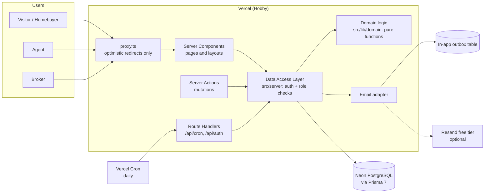
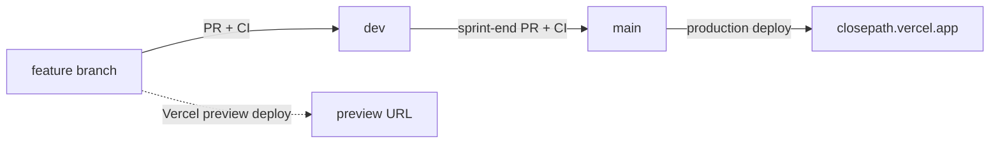
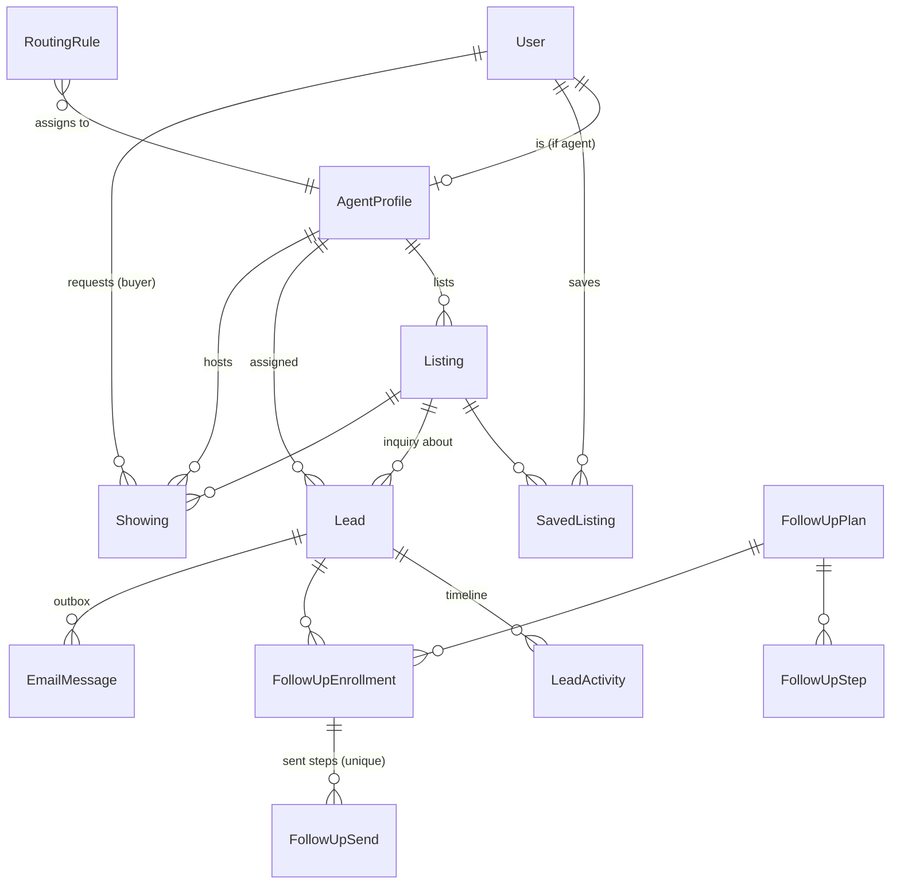

# Architecture

## System overview





## Stack

| Layer | Choice | Why |
|---|---|---|
| Framework | Next.js 16 (App Router), React 19, TypeScript (strict) | One full-stack codebase. Course standard. Vercel preview deploys. |
| UI | Tailwind CSS 4 + shadcn/ui | Accessible components we own and can edit. No runtime CSS cost. |
| Database | PostgreSQL 18: Neon (free tier) in the cloud, Docker on our own computers | Relational data (leads, showings, rules). Neon is free and works with Vercel. Docker gives each of us a local copy for development and tests. See ADR-12. |
| ORM | Prisma 7 with the standard PostgreSQL driver adapter (`@prisma/adapter-pg`) | Type-safe queries, migrations, seed script. Queries are parameterized (no SQL injection). The same adapter works with Neon, the local Docker database and CI (ADR-12). Pin `prisma@7`, because npm's `latest` tag for the `prisma` CLI points to an 8.0 release candidate. |
| Auth | Better Auth (email + password, roles) | See ADR-3. |
| Validation | Zod | One schema validates forms on the client and the server. |
| Email | Outbox table + Resend free tier (optional) | See ADR-6. |
| Testing | Vitest, Testing Library, Playwright, fast-check, Stryker | See [testing.md](testing.md). |
| CI/CD | GitHub Actions + Vercel | Free on a public repo. See [security.md](security.md) for the security gates. |

## Architecture decisions (ADRs)

**ADR-0: Stable releases only.** Every dependency uses its newest stable release, never beta, RC, canary or alpha. This is a team decision (Nov 18). Before installing, check `npm view <pkg> dist-tags`, because some `latest` tags point to pre-releases.

**ADR-1: Next.js 16 App Router as the full stack.** Pages, mutations (Server Actions) and APIs (Route Handlers) live in one app. This version differs from older Next.js: `middleware.ts` is now `proxy.ts`, request APIs such as `cookies()` and `params` are async, and Cache Components are on (ADR-11). Always check `node_modules/next/dist/docs/` first.

**ADR-2: PostgreSQL on Neon with Prisma.** The data is relational (a lead has activities, showings and an agent). Neon's free tier includes branching, so previews can use a separate database branch from production. Local development and tests use Docker instead (ADR-12).

**ADR-3: Better Auth instead of Auth.js.** The rubric accepts "Auth.js/NextAuth, Clerk, or equivalent." As of Nov 2026, Auth.js v5 is still in beta (`5.0.0-beta.32`). Better Auth is stable (1.7.x), supports Next.js 16 and Prisma 7, has email and password sign-in with built-in rate limiting, and is the first library the Next.js auth guide lists. Each user has a `role`: `HOMEBUYER`, `AGENT` or `BROKER`.

**ADR-4: A Data Access Layer (DAL) checks every read and write.** All database access goes through `src/server/`. Each function gets the current user, checks role and ownership (for example, "this lead is assigned to this agent"), and returns only the fields the UI needs. Pages, components and Server Actions never call Prisma directly. `proxy.ts` only does fast redirects for signed-out users; it is never the real security check. This follows the Next.js "Data Security" guide.

**ADR-5: Business rules are pure functions in `src/lib/domain/`.** Lead scoring, the call list, routing, showing slots and overlap, and template rendering take plain data in and return plain data out, with no database, network or clock (callers pass `now`). This makes them easy to build with TDD, property-test with fast-check, and mutation-test with Stryker.

**ADR-6: Email goes through an adapter.** `sendEmail()` always writes the message to the `EmailMessage` table (the in-app outbox). If `RESEND_API_KEY` is set, it also sends through Resend. Without a verified domain, Resend's free tier only delivers to the account owner's address, so the outbox is how demos and graders see every email. Tests use the outbox only.

**ADR-7: Scheduled follow-ups run from Vercel Cron, plus a manual button.** Vercel Hobby cron jobs run at most once a day, so `/api/cron/follow-ups` runs daily and the broker has a "Send due emails now" button for demos. The job is idempotent: a unique `(enrollmentId, stepId)` record stops double sends. The route requires `CRON_SECRET`.

**ADR-8: Demo listings are generated once and committed.** About 80 fictional listings in `prisma/seed/listings.json` are loaded by `prisma/seed.ts`. People (agents, buyers, leads) come from `@faker-js/faker` with a fixed seed, so every run creates the same data. Photos are public placeholder or Unsplash URLs allowed in `next.config.ts` `images.remotePatterns`. No MLS data.

**ADR-9: No AI inside the app.** Any in-app model call would need a paid API key, so it is excluded to keep the project at $0. Claude Code is used for development, sub-agents and the AI PR review in CI, which run on the team's Claude subscription.

**ADR-10: One brokerage (single tenant).** No `organizationId` on every table. This keeps queries and authorization simple.

**ADR-11: Cache Components are on (`cacheComponents: true`).**
- Public listing data can use `"use cache"` with `cacheTag("listings")`.
- Anything that depends on the signed-in user (session, saved homes, leads) is read inside a `<Suspense>` boundary and is never placed in a shared cache.
- After a mutation, call `updateTag`, `revalidateTag` or `refresh` as the Next.js 16 caching docs describe.

**ADR-12: Local PostgreSQL in Docker, and Prisma's standard `pg` adapter (Nov 19).**
- `compose.yaml` runs PostgreSQL 18 (Neon's default version for new projects) on our own computers, with two databases: `closepath_dev` for `npm run dev` and `closepath_test` for integration tests. CI will start the same image as a service container, so tests run against the same database locally and in CI.
- Prisma uses `@prisma/adapter-pg` (node-postgres) everywhere. The Neon adapter (`@prisma/adapter-neon`) wraps Neon's serverless driver, which connects through Neon's own proxy and can't reach a plain PostgreSQL, so it would not work with Docker or CI. Neon also accepts standard connections, so in Vercel `DATABASE_URL` is Neon's pooled connection string. Only the URL changes between environments.
- **Why:** integration tests truncate and reseed tables again and again (F2-AC1 access checks, F5-AC5 double-booking). Locally that is faster, works offline, and doesn't use up Neon's free-tier compute. Docker Desktop is free for personal and education use, so the project still costs $0.
- **Without Docker:** a partner can point `.env.test` at a Neon branch named `test` instead. The code doesn't change.
- This narrows ADR-2: Neon is now for preview and production.

## Data model (first draft)



| Model | Key fields |
|---|---|
| `User` | id, name, email, role (`HOMEBUYER`, `AGENT`, `BROKER`), auth tables managed by Better Auth |
| `AgentProfile` | userId, phone, active, lastAssignedAt (for round-robin) |
| `Listing` | address, city, zip, price (whole dollars, int), beds, baths, sqft, propertyType, status, photos[], agentId |
| `Lead` | name, email, phone?, status, source, listingId?, agentId, lastContactedAt?, unsubscribed |
| `LeadActivity` | leadId, type, body?, authorId?, createdAt |
| `Showing` | listingId, buyerId, agentId, startsAt, endsAt (UTC), status (`REQUESTED`, `CONFIRMED`, `DECLINED`, `CANCELLED`) |
| `RoutingRule` | priority, cities[], minPrice?, maxPrice?, agentId |
| `FollowUpPlan` / `FollowUpStep` | name / dayOffset, subject, body |
| `FollowUpEnrollment` / `FollowUpSend` | leadId, planId, enrolledAt, stoppedAt? / unique (enrollmentId, stepId) |
| `EmailMessage` | to, subject, body, leadId?, provider (`outbox`, `resend`), sentAt |

All timestamps are stored in UTC and shown in `America/Los_Angeles`.

## Folder layout

```
src/
  app/                      # routes only: pages, layouts, loading/error UI
    (public)/listings/      # F1 search + listing page
    (buyer)/saved/  (buyer)/showings/
    agent/                  # F2, F3 (agent role)
    broker/                 # F4 (broker role)
    api/auth/[...all]/      # Better Auth handler
    api/cron/follow-ups/    # F3 scheduled job
  components/
    ui/                     # shadcn/ui primitives (generated)
    <feature>/              # feature components
  lib/
    domain/                 # pure business rules (scoring, routing, slots, templates)
    validation/             # Zod schemas
    utils/
  server/                   # Data Access Layer + Server Actions ("server-only")
    auth.ts                 # getCurrentUser, requireRole
    actions/
  proxy.ts                  # optimistic auth redirects only
prisma/
  schema.prisma  seed.ts  seed/listings.json
e2e/                        # Playwright specs
docker/postgres/init/       # SQL run on the container's first start (creates closepath_test)
compose.yaml                # local PostgreSQL 18 (ADR-12)
```

## Environments and configuration

| Environment | App | Database | Notes |
|---|---|---|---|
| Local | `npm run dev` | Docker PostgreSQL, database `closepath_dev` (`docker compose up -d`) | `.env.local` (never committed) |
| Test/CI | Vitest, Playwright | Locally: `closepath_test` in the same Docker container. CI: a `postgres:18-alpine` service container in GitHub Actions | `.env.test` locally (never committed); values set in the workflow in CI |
| Preview | Vercel preview per PR | Neon `preview` branch | Vercel env vars |
| Production | `closepath.vercel.app` (from `main`) | Neon `main` branch | Vercel env vars |

Environment variables (`.env.example` lists them with placeholder values):

- `DATABASE_URL`
- `BETTER_AUTH_SECRET`, `BETTER_AUTH_URL`
- `CRON_SECRET`
- `RESEND_API_KEY` (optional)
